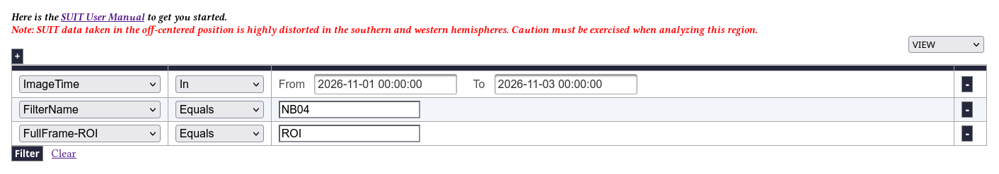
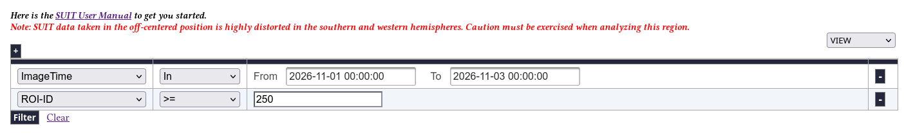
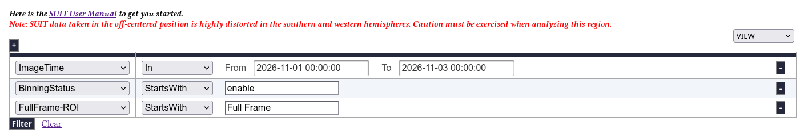
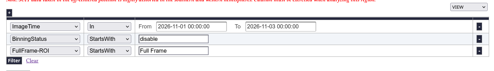

.. _pradan:

============================================
Searching and Downloading SUIT Data (PRADAN)
============================================

SUIT data products are distributed to the public through **PRADAN**, the data
portal of the Indian Space Science Data Centre (ISSDC). This page shows how to
search the SUIT archive with the portal's filter panel and download the files
you need.

.. contents:: On this page
   :local:
   :depth: 2

What is available
=================

.. list-table::
   :header-rows: 1
   :widths: 20 80

   * - Level
     - Availability on PRADAN
   * - Level-1
     - Calibrated images (bias, gain, flat field, PRNU, scatter and WCS).
       Published within about 24 hours of observation.
   * - Level-2
     - Level-1 plus distortion correction, spike removal and
       contamination / limb-darkening correction. Published within about
       7 days of observation, as a multi-extension FITS file with a
       ``SPIKE_TABLE`` extension.

Level-0 data is not public. For how each level is produced, see
:doc:`level1` and :doc:`level2`.

Step 1: Open the SUIT page on PRADAN
====================================

1. Go to the Aditya-L1 PRADAN portal: https://pradan1.issdc.gov.in/al1/
2. Log in with your ISSDC account. If you do not have one, register on the
   portal first.
3. Open the **SUIT** payload page. The filter panel and the results table
   are on this page.

.. TODO: add a screenshot of the PRADAN landing / login page here, e.g.
   .. figure:: pradan/login.png

.. note::

   The banner at the top of the SUIT page is a standing caution: **SUIT data
   taken in the off-centred pointing position is highly distorted in the
   southern and western hemispheres.** Take care when analysing those regions.

Step 2: Build a search with the filter panel
============================================

Each row of the filter panel is one condition, made of a **Parameter**, an
**Operator** and a **Value**. A file is returned only if it matches *every*
row, so each row you add narrows the search.

   The filter panel with three rows: an ``ImageTime`` range,
   ``FilterName Equals NB04`` and ``FullFrame-ROI Equals ROI``.

Panel controls
--------------

.. list-table::
   :header-rows: 1
   :widths: 25 75

   * - Control
     - Use
   * - **Parameter** (left)
     - The metadata field to search on. All fields are listed in
       :ref:`pradan-parameters`.
   * - **Operator** (middle)
     - How the value is compared (see :ref:`pradan-operators`).
   * - **Value** (right)
     - The value to match. For time fields, enter a **From** and **To** time
       as ``YYYY-MM-DD hh:mm:ss``.
   * - ``+`` (top left)
     - Add a new filter row.
   * - ``-`` (end of row)
     - Remove that filter row.
   * - **Filter**
     - Run the search and refresh the results table.
   * - **Clear**
     - Remove all filter values.

.. _pradan-operators:

Operators
---------

.. list-table::
   :header-rows: 1
   :widths: 18 32 50

   * - Operator
     - Use with
     - Example
   * - ``In``
     - Time fields (a From–To range)
     - ``ImageTime`` ``In`` ``2026-11-01 00:00:00`` to ``2026-11-03 00:00:00``
   * - ``Equals``
     - Exact match on text or numbers
     - ``FilterName`` ``Equals`` ``NB04``
   * - ``StartsWith``
     - Text that begins with the value
     - ``BinningStatus`` ``StartsWith`` ``enable``
   * - ``>=``
     - Numbers at or above the value
     - ``ROI-ID`` ``>=`` ``250``

.. tip::

   Always include an ``ImageTime`` row. SUIT takes a binned full-disk image
   every minute, so a search without a time range can return a very large
   number of files.

Step 3: Common searches
=======================

Each example below limits the search to 1–3 November 2026 with ``ImageTime``.
Change the dates to the period you need, then press **Filter**.

Case 1: ROI data in one filter
------------------------------

.. list-table::
   :header-rows: 1
   :widths: 30 20 50

   * - Parameter
     - Operator
     - Value
   * - ImageTime
     - ``In``
     - ``2026-11-01 00:00:00`` to ``2026-11-03 00:00:00``
   * - FilterName
     - ``Equals``
     - ``NB04`` (or any filter)
   * - FullFrame-ROI
     - ``Equals``
     - ``ROI``

   Case 1: ROI observations in NB04.

Case 2: Flare observations
--------------------------

ROI-IDs ``250`` and ``255`` are used for flare-triggered observations, so
``ROI-ID >= 250`` returns flare data.

.. list-table::
   :header-rows: 1
   :widths: 30 20 50

   * - Parameter
     - Operator
     - Value
   * - ImageTime
     - ``In``
     - ``2026-11-01 00:00:00`` to ``2026-11-03 00:00:00``
   * - ROI-ID
     - ``>=``
     - ``250``

   Case 2: flare-triggered observations.

Case 3: 2k × 2k binned full-frame data
--------------------------------------

.. list-table::
   :header-rows: 1
   :widths: 30 20 50

   * - Parameter
     - Operator
     - Value
   * - ImageTime
     - ``In``
     - ``2026-11-01 00:00:00`` to ``2026-11-03 00:00:00``
   * - BinningStatus
     - ``StartsWith``
     - ``enable``
   * - FullFrame-ROI
     - ``StartsWith``
     - ``Full Frame``

   Case 3: 2048 × 2048 binned full-disk images.

Case 4: 4k × 4k full-resolution images
--------------------------------------

.. list-table::
   :header-rows: 1
   :widths: 30 20 50

   * - Parameter
     - Operator
     - Value
   * - ImageTime
     - ``In``
     - ``2026-11-01 00:00:00`` to ``2026-11-03 00:00:00``
   * - BinningStatus
     - ``StartsWith``
     - ``disable``
   * - FullFrame-ROI
     - ``StartsWith``
     - ``Full Frame``

   Case 4: 4096 × 4096 full-resolution full-disk images.

.. tip::

   To restrict Case 3 or Case 4 to one filter, add a row
   ``FilterName`` ``Equals`` ``NB03`` (or any other filter). Binned synoptic
   images are taken in NB03.

Step 4: Download the data
=========================

1. Press **Filter**. The matching files are listed in the results table
   below the panel.
2. Use the **VIEW** menu (top right of the panel) to change how the results
   are shown.
3. Select the files you want and download them.

.. TODO: add screenshots of the results table and of the download step, e.g.
   .. figure:: pradan/results_table.png
   .. figure:: pradan/download.png
   and confirm the exact selection / download controls (per-file links,
   select-all, bulk download, any file-count or size limit).

Once downloaded, the files can be opened with Astropy, SunPy or JHelioviewer.
The SUIT Data User Manual (linked at the top of the SUIT page on PRADAN) has
example code.

.. _pradan-parameters:

Reference: search parameters
============================

.. list-table::
   :header-rows: 1
   :widths: 22 18 30 30

   * - Parameter
     - Data type
     - Description
     - Accepted values / example
   * - ImageTime
     - TIME_DURATION
     - Image acquisition date and time
     - ``2025-05-10T12:30:00``
   * - FilterName
     - STRING
     - SUIT science filter used
     - ``NB01`` … ``NB08``, ``BB01`` … ``BB03``. One value per row; the
       leading zero is required.
   * - BinningStatus
     - STRING
     - Detector binning during acquisition
     - ``enable``, ``disable``
   * - FullFrame-ROI
     - STRING
     - Full frame or Region of Interest
     - ``Full Frame``, ``ROI``
   * - ROI-ID
     - INTEGER
     - Region of Interest identifier
     - ``1`` … ``249``. ``250`` and ``255`` are flare observations.
   * - ROI_InArcSeconds
     - EUCLIDEAN_LOCATION_BOX
     - ROI location on the disk in arcseconds, relative to Sun centre
       (``(0,0)``)
     - Bottom-left ``(-300,150)``, upper-right ``(200,300)``
   * - Filename
     - STRING
     - Name of the FITS file
     - Use ``contains`` to match parts of the name, e.g. ``Lev2.0`` or
       ``NB03``.
   * - WavelengthInAngstrom
     - INTEGER
     - Central wavelength of the filter
     - See :ref:`pradan-wavelengths`
   * - ObservationDescription
     - STRING
     - Free-text description of the observation
     - ``Quiet Sun``, ``Active Region``
   * - ProcessingLevel
     - STRING
     - Data processing level
     - ``level1``, ``level2``
   * - ProposalID
     - STRING
     - Proposal identifier
     - ``T26_0477``
   * - ObservationID
     - STRING
     - Unique observation identifier
     - ``T26_0477_001998``
   * - SunCenterXInPx
     - DOUBLE
     - Sun-centre X position on the detector (pixels)
     - ``1024.5``
   * - SunCenterYInPx
     - DOUBLE
     - Sun-centre Y position on the detector (pixels)
     - ``1023.8``
   * - ObservationMode
     - INTEGER
     - Program sequence ID (hexadecimal)
     - ``97`` = Synoptic4Output, ``2``, ``3``
   * - ReleaseDate
     - DATE_DURATION
     - Date the product became public
     - ``2026-01-01``
   * - Quality
     - INTEGER
     - Quality flag, 0–10
     - ``10`` = good data, ``< 10`` = partial data
   * - CreationTime
     - TIME_DURATION
     - Time the product was generated
     - ``2025-05-10T13:15:22``

.. _pradan-wavelengths:

Filter wavelengths
------------------

.. list-table::
   :header-rows: 1
   :widths: 25 25 25 25

   * - Filter
     - Wavelength (Å)
     - Filter
     - Wavelength (Å)
   * - NB01
     - 2140
     - NB07
     - 3880
   * - NB02
     - 2767
     - NB08
     - 3968
   * - NB03
     - 2796
     - BB01
     - 2200
   * - NB04
     - 2803
     - BB02
     - 2770
   * - NB05
     - 2832
     - BB03
     - 3400
   * - NB06
     - 3000
     -
     -
